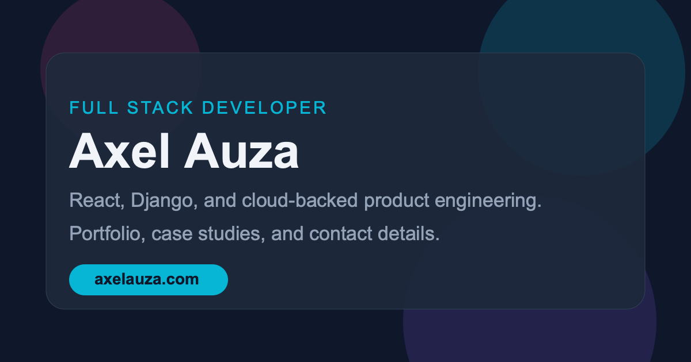

# Axel Auza — Portfolio

Personal portfolio of Axel Auza, full stack developer. Built with Next.js
(Pages router), React, and Tailwind CSS, with animated sections for projects,
experience, about, and contact.

**Live demo:** https://portfolio-axelauza97.vercel.app/

<!-- CI badge: add once the GitHub Actions workflow from issue #5 lands.
     There is no CI workflow in this repo yet, so no badge URL exists. -->



_The site's Open Graph preview card (`public/og-image.png`, 1200×630).
See the [live demo](https://portfolio-axelauza97.vercel.app/) for the
full site._

## Features

- **Hero** — animated intro with typewriter role line, social links
  (GitHub, LinkedIn, email), and calls to action.
- **Projects** — six featured projects with tag filters, live demo and
  source links per project.
- **Experience** — role timeline with delivery highlights and tech tags.
- **About** — background, degree, tech stack, and YOLOv4 thermal-channel
  thesis work (with video).
- **Contact** — contact form backed by the `/api/sendEmail` route (Resend).
- **Polish** — custom cursor, magnetic buttons, scroll progress, spotlight
  effects, and reveal-on-scroll animations (Framer Motion, GSAP,
  keen-slider).
- **SEO** — unique title, meta description, and Open Graph / Twitter Card
  tags on every page, JSON-LD structured data on the home page,
  `sitemap.xml`, `robots.txt`, and a 1200×630 OG preview image
  (`public/og-image.png`).

## Tech stack

- [Next.js](https://nextjs.org/) 13.4.6 (Pages router) + React 18
- [Tailwind CSS](https://tailwindcss.com/) 3
- Animation: Framer Motion, GSAP, keen-slider, typewriter-effect
- Contact form: Resend (`/api/sendEmail`)
- Analytics: Vercel Analytics (production only)
- Deployed on [Vercel](https://vercel.com/)

## Run locally

Requires **Node.js 20.x** (see `engines` in `package.json`).

```bash
npm ci          # install dependencies
npm run dev     # start dev server at http://localhost:3000
npm run build   # production build
npm start       # serve the production build
npm run lint    # Next.js ESLint checks
npm run format  # Prettier (writes in place)
```

The contact form needs a `NEXT_PUBLIC_RESEND_API_KEY` in the environment
to actually send email; without it the form route will fail at send time
(see `pages/api/sendEmail.js`).

## Routes

| Route         | What it renders                                              |
| ------------- | ------------------------------------------------------------ |
| `/`           | Home — hero, projects, experience, about, contact sections   |
| `/privacy`    | Privacy policy                                               |
| `/about`      | Redirects to `/#about` (standalone page exists but is unused) |
| `/experience` | Redirects to `/#experience` (same as above)                 |

The `/about` and `/experience` redirects are temporary redirects defined
in `next.config.js`; the home page anchors are the canonical locations.

## Project structure

```text
pages/            # Routes: index, about, experience, privacy, api/sendEmail
components/
  sections/       # Hero, Projects, Experience, About, Contact
  layout/         # Layout, Navbar, MainNavigation, Footer
  UI/             # Buttons, cursor, loader, modal, cards, effects
  experiences/    # Experience timeline list
  common/         # Shared cards, headings, tech badges
mocks/            # Project and experience data
public/           # Static assets, og-image.png, sitemap.xml, robots.txt
styles/           # Tailwind + CSS modules
tests/visual/     # Playwright visual QA (screenshots, overflow checks)
```

## Contributing

Issues and pull requests are welcome. Please open an issue first for
larger changes so the approach can be agreed on before work starts.
